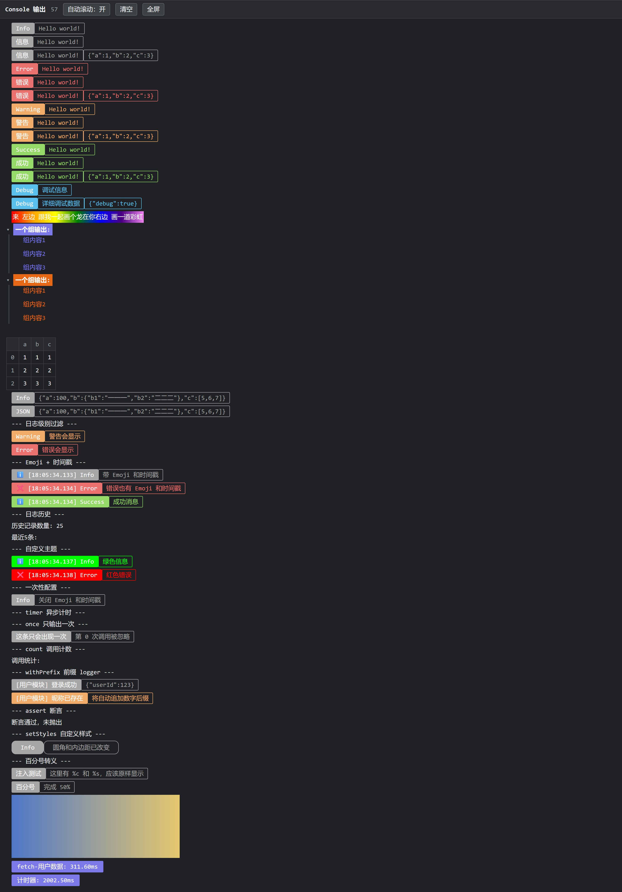

# @wb04307201/pretty-log

> 一个前端工具包，用于美化控制台日志输出。它可以帮助开发者在浏览器控制台中以更清晰、更易读的格式输出日志信息。

[](https://nodei.co/npm/@wb04307201/pretty-log/)

## 安装
```sh
npm install @wb04307201/pretty-log
```

## 使用
```javascript
import * as prettyLog from '@wb04307201/pretty-log';

// 信息
prettyLog.info("Hello world!")
prettyLog.info("信息", "Hello world!")

// 错误
prettyLog.error("Hello world!")
prettyLog.error("错误", "Hello world!")

// 警告
prettyLog.warning("Hello world!")
prettyLog.warning("警告", "Hello world!")

// 成功
prettyLog.success("Hello world!")
prettyLog.success("成功", "Hello world!")

// 调试
prettyLog.debug("调试信息")

// 彩虹
prettyLog.rainbow("来 左边 跟我一起画个龙在你右边 画一道彩虹")

// 组输出，默认展开
prettyLog.group("一个组输出", ["组内容1", "组内容2", "组内容3"])

// 组输出，折叠
prettyLog.group("一个组输出", ["组内容1", "组内容2", "组内容3"], false)

// 表格
prettyLog.table([{a: 1, b: 1, c: 1}, {a: 2, b: 2, c: 2}, {a: 3, b: 3, c: 3}])

// 计时器
prettyLog.time('计时器');
// 执行一些操作...
setTimeout(() => {
    prettyLog.timeEnd('计时器');
}, 2000); // 2000 毫秒 = 2 秒

// 图片
prettyLog.picture("https://example.com/image.png", 0.2)

// json格式
prettyLog.info({a: 100, b: {b1: '一一一', b2: '二二二'}, c: [5, 6, 7]})
prettyLog.info("JSON", {a: 100, b: {b1: '一一一', b2: '二二二'}, c: [5, 6, 7]})
```

## 高级功能

### 日志级别过滤
```javascript
// 只显示 warn 及以上级别（debug 和 info 被过滤）
prettyLog.setLogLevel('warn');
prettyLog.debug('不会显示');
prettyLog.warning('会显示');

// 级别: 'debug' < 'info' < 'warn' < 'error' < 'none'
prettyLog.setLogLevel('none');  // 关闭所有输出
```

### Emoji 前缀
```javascript
prettyLog.showEmoji(true);
prettyLog.info("带 Emoji");   // ℹ️ Info ...
prettyLog.error("出错了");    // ❌ Error ...
prettyLog.showEmoji(false);   // 关闭
```

### 时间戳
```javascript
prettyLog.showTimestamp(true);
prettyLog.info("带时间戳");  // [14:32:05.123] Info ...
```

### 自定义主题
```javascript
prettyLog.setTheme({
  infoColor: '#00FF00',
  errorColor: '#FF0000',
  groupColor: '#FF00FF',
});
```

### 一次性配置
```javascript
prettyLog.configure({
  logLevel: 'info',
  showEmoji: true,
  showTimestamp: true,
  theme: { infoColor: '#00FF00' },
});
```

### 日志历史
```javascript
// 获取最近的日志记录（默认缓存最近 200 条）
const history = prettyLog.getHistory();
console.log(JSON.stringify(history, null, 2));

// 调整历史大小（设为 0 禁用）
prettyLog.setHistorySize(500);

// 清空历史
prettyLog.clearHistory();
```

## 输出

