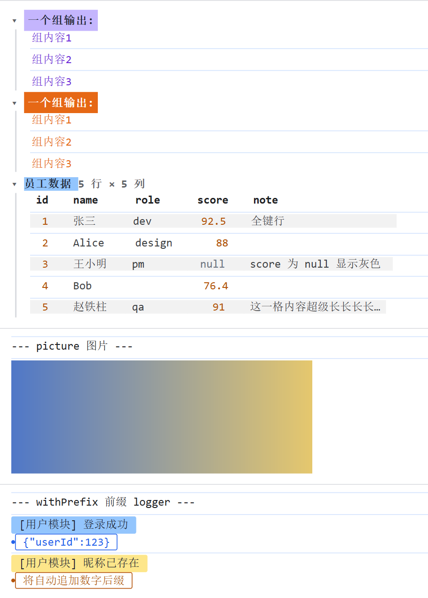
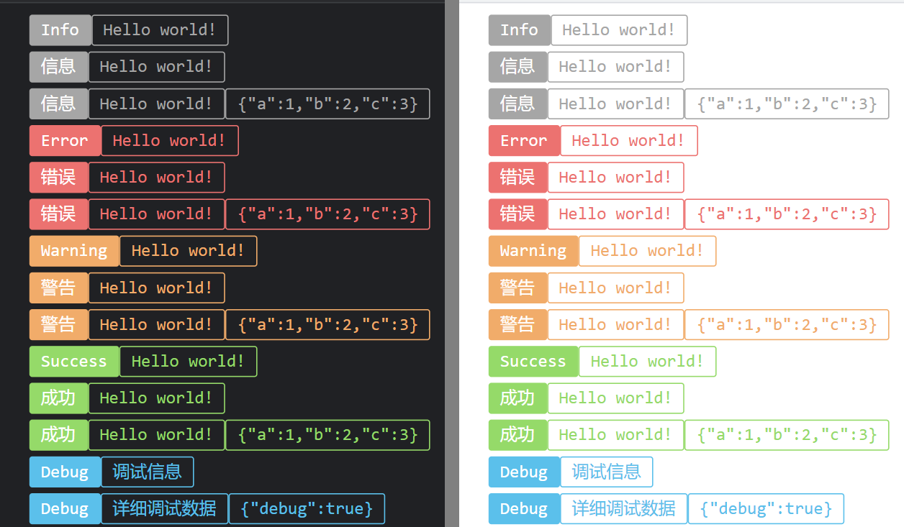

# @wb04307201/pretty-log

> A frontend toolkit for beautifying console log output. It helps developers display log information in a cleaner, more readable format in the browser console.

[简体中文](README.zh-CN.md) | [English](README.md)

[](https://nodei.co/npm/@wb04307201/pretty-log/)


## Contributing

This project uses automated releases driven by git tags. See [RELEASING.md](RELEASING.md) for the tag workflow and the required repository secret.

## Installation
```sh
npm install @wb04307201/pretty-log
```

## Usage
```javascript
import * as prettyLog from '@wb04307201/pretty-log';

// Info
prettyLog.info("Hello world!")
prettyLog.info("Custom Title", "Hello world!")

// Error
prettyLog.error("Hello world!")
prettyLog.error("Error Title", "Something went wrong!")

// Warning
prettyLog.warning("Hello world!")
prettyLog.warning("Warning Title", "Be careful!")

// Success
prettyLog.success("Hello world!")
prettyLog.success("Success Title", "Operation completed!")

// Debug
prettyLog.debug("Debug message")
prettyLog.debug("Debug Title", "Detailed debug data", {verbose: true})

// Rainbow
prettyLog.rainbow("Colorful rainbow text in the console")

// Group output, expanded by default
prettyLog.group("A Group", ["Item 1", "Item 2", "Item 3"])

// Group output, collapsed
prettyLog.group("A Collapsed Group", ["Item 1", "Item 2", "Item 3"], false)

// Table
prettyLog.table([{a: 1, b: 1, c: 1}, {a: 2, b: 2, c: 2}, {a: 3, b: 3, c: 3}])

// Timer
prettyLog.time('myTimer');
// Do some work...
setTimeout(() => {
    prettyLog.timeEnd('myTimer');
}, 2000); // 2000 ms = 2 seconds

// Image
prettyLog.picture("https://example.com/image.png", 0.2)

// JSON format
prettyLog.info({a: 100, b: {b1: 'one', b2: 'two'}, c: [5, 6, 7]})
prettyLog.info("JSON", {a: 100, b: {b1: 'one', b2: 'two'}, c: [5, 6, 7]})
```



## Advanced Features

### Log Level Filtering
```javascript
// Only show warn and above (debug and info are filtered out)
prettyLog.setLogLevel('warn');
prettyLog.debug('will not show');
prettyLog.warning('will show');

// Levels: 'debug' < 'info' < 'warn' < 'error' < 'none'
prettyLog.setLogLevel('none');  // Disable all output
```

### Emoji Prefix
```javascript
prettyLog.showEmoji(true);
prettyLog.info("With emoji");   // ℹ️ Info ...
prettyLog.error("An error");    // ❌ Error ...
prettyLog.showEmoji(false);     // Disable
```

### Timestamp
```javascript
prettyLog.showTimestamp(true);
prettyLog.info("With timestamp");  // [14:32:05.123] Info ...
```

### Custom Theme
```javascript
prettyLog.setTheme({
  infoColor: '#00FF00',
  errorColor: '#FF0000',
  groupColor: '#FF00FF',
});
```



> Styles are designed for dark consoles; text contrast drops somewhat on light backgrounds (right side).

### One-Shot Configuration
```javascript
prettyLog.configure({
  logLevel: 'info',
  showEmoji: true,
  showTimestamp: true,
  theme: { infoColor: '#00FF00' },
});
```

### Log History
```javascript
// Get recent log entries (default buffer size: 200)
const history = prettyLog.getHistory();
console.log(JSON.stringify(history, null, 2));

// Adjust history size (set to 0 to disable).
// Illegal values are clamped rather than throwing, and existing
// entries are preserved (most recent kept when shrinking).
prettyLog.setHistorySize(500);

// Clear history
prettyLog.clearHistory();
```

### Async Timer
`timer` ends the timer on both the resolve and the throw/reject path, and never swallows the original error.
```javascript
// Sync work — logs immediately
const result = prettyLog.timer('parse', () => JSON.parse(raw));

// Async work — logs when the promise settles
await prettyLog.timer('fetch-user', () => fetch('/api/user').then(r => r.json()));

// Errors still end the timer and propagate to your caller
await prettyLog.timer('risky', () => Promise.reject(new Error('boom')));
```

### Log Once
Useful for debug logs inside loops — the same key prints only once.
```javascript
for (const item of items) {
  prettyLog.once('render', 'Component rendered', item.id);
}

prettyLog.clearOnce();  // allow all keys again
```

### Call Counting
```javascript
items.forEach(i => prettyLog.count('api-call'));

console.log(prettyLog.countSummary());  // { 'api-call': 42 }
prettyLog.clearCounters();
```

### Prefixed Logger
Returns loggers that carry a fixed prefix while keeping the same level, theme and filtering.
```javascript
const userLog = prettyLog.withPrefix('用户模块');
userLog.info('登录成功', { userId: 123 });
// [用户模块] 登录成功
// {"userId":123}
```

### Assertions
Stays silent when the condition holds; on failure it logs via `console.error` (highlighted red in DevTools) and throws.
```javascript
prettyLog.assert(user != null, 'user must not be null');
```

### Custom Styles
```javascript
prettyLog.setStyles({ borderRadius: '8px', padding: '3px 10px' });

// Pass undefined to restore a default
prettyLog.setStyles({ borderRadius: undefined });
```

### Production Strip
Every logging API becomes a silent no-op when `NODE_ENV=production`, so debug calls can stay in the source without polluting production bundles.
```javascript
// In production this prints nothing
prettyLog.info('this never shows up');
```

Note: `timer` still runs the function you give it in production — only the logging is suppressed.

### Trigger-Word Animations (Easter Egg)
When the stringified log text contains a trigger word, a full-screen particle animation plays in the page. Matching is a case-sensitive substring check in table order — the first hit wins, one animation per log call, and consecutive hits only play once (about a 2-second cooldown after each play).


Default trigger table:

| Trigger word | Animation |
|---|---|
| 打雷 | `lightning` |
| 雷人 | `lightning` |
| 下雨 | `rain` |
| 暴雨 | `rain` |
| 翻车了 | `rain` |
| 凉了 | `rain` |
| 寄了 | `rain` |
| 芭比Q了 | `rain` |
| 下雪 | `snow` |
| 雪花 | `snow` |
| 初雪 | `snow` |
| 烟花 | `fireworks` |
| 撒花 | `confetti` |
| 庆祝 | `confetti` |
| 好耶 | `confetti` |
| 恭喜 | `confetti` |

Key order is match priority: bad-news words come first, so '庆祝上线翻车了' plays rain (翻车了 beats 庆祝).

```javascript
import { configure, setEffects, DEFAULT_EFFECT_TRIGGERS } from '@wb04307201/pretty-log';

// setEffects({ triggers }) replaces the whole table — spread
// DEFAULT_EFFECT_TRIGGERS to keep the defaults and extend them
setEffects({ triggers: { ...DEFAULT_EFFECT_TRIGGERS, '开工': 'confetti' } });

// One-shot kill switch
setEffects({ enabled: false });

// Also configurable through configure()
configure({ effects: { enabled: true, cooldownMs: 2000 } });
```

Note: no animation plays when `NODE_ENV=production`.
Note: no animation plays when the user prefers reduced motion (`prefers-reduced-motion: reduce`).
