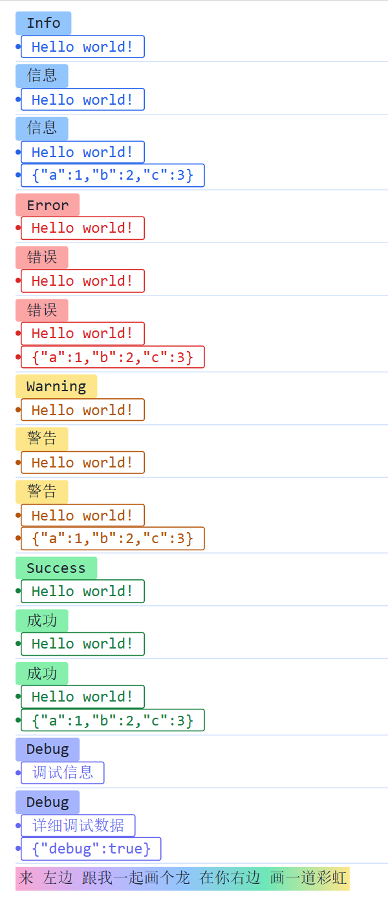
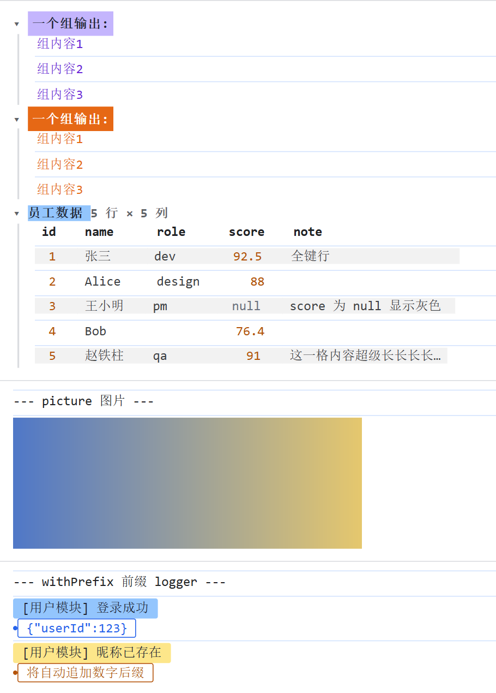
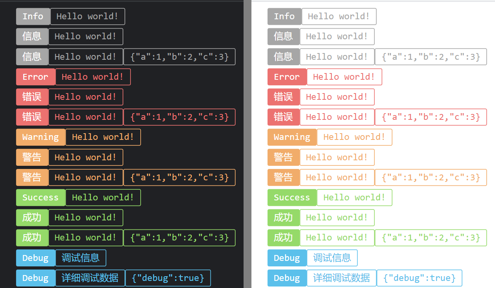
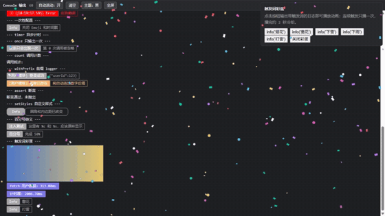

# @wb04307201/pretty-log

> 一个前端工具包，用于美化控制台日志输出。它可以帮助开发者在浏览器控制台中以更清晰、更易读的格式输出日志信息。

[简体中文](README.zh-CN.md) | [English](README.md)

[](https://nodei.co/npm/@wb04307201/pretty-log/)



## 安装
```sh
npm install @wb04307201/pretty-log
```

## 使用
```javascript
import * as prettyLog from '@wb04307201/pretty-log';

// 信息
prettyLog.info("Hello world!")
prettyLog.info("自定义标题", "Hello world!")

// 错误
prettyLog.error("Hello world!")
prettyLog.error("错误标题", "出错了!")

// 警告
prettyLog.warning("Hello world!")
prettyLog.warning("警告标题", "请小心!")

// 成功
prettyLog.success("Hello world!")
prettyLog.success("成功标题", "操作完成!")

// 调试
prettyLog.debug("调试信息")
prettyLog.debug("调试标题", "详细调试数据", {verbose: true})

// 彩虹
prettyLog.rainbow("来 左边 跟我一起画个龙在你右边 画一道彩虹")

// 组输出，默认展开
prettyLog.group("一个组输出", ["组内容1", "组内容2", "组内容3"])

// 组输出，折叠
prettyLog.group("一个组输出", ["组内容1", "组内容2", "组内容3"], false)

// 表格
prettyLog.table([{a: 1, b: 1, c: 1}, {a: 2, b: 2, c: 2}, {a: 3, b: 3, c: 3}])

// 计时器
prettyLog.time('myTimer');
// 执行一些操作...
setTimeout(() => {
    prettyLog.timeEnd('myTimer');
}, 2000); // 2000 毫秒 = 2 秒

// 图片
prettyLog.picture("https://example.com/image.png", 0.2)

// JSON 格式
prettyLog.info({a: 100, b: {b1: '一一一', b2: '二二二'}, c: [5, 6, 7]})
prettyLog.info("JSON", {a: 100, b: {b1: '一一一', b2: '二二二'}, c: [5, 6, 7]})
```



## 高级功能

### 日志级别过滤
```javascript
// 只显示 warn 及以上级别（debug 和 info 被过滤）
prettyLog.setLogLevel('warn');
prettyLog.debug('不会显示');
prettyLog.warning('会显示');

// 级别: 'debug' < 'info' < 'warn' < 'error' < 'none'
prettyLog.setLogLevel('none');  // 关闭所有输出
```

### Emoji 前缀
```javascript
prettyLog.showEmoji(true);
prettyLog.info("带 Emoji");   // ℹ️ Info ...
prettyLog.error("出错了");    // ❌ Error ...
prettyLog.showEmoji(false);   // 关闭
```

### 时间戳
```javascript
prettyLog.showTimestamp(true);
prettyLog.info("带时间戳");  // [14:32:05.123] Info ...
```

### 自定义主题
主题按「职责分离」组织：`fills` 是徽章填充色，`texts` 是文字色，`badgeText` 是徽章文字色，`rainbow` 是彩虹渐变，`mode` 切换深/浅控制台底。
```javascript
// 部分覆盖：未提及的键不动
prettyLog.setTheme({
  mode: 'light',                 // 'dark'（默认）| 'light'
  badgeText: '#1f2330',          // 徽章文字色
  fills: { info: '#00FF00' },    // 徽章填充色（深浅两底通用）
  texts: { error: '#FF0000' },   // 文字色（按 mode 取对应预设）
  rainbow: { colors: ['#f9a8d4', '#93c5fd'], text: '#23273a' },
});

prettyLog.getTheme();    // 当前主题（预设 + 用户覆盖的合并结果）
prettyLog.resetTheme();  // 清空全部覆盖并回到 dark
```

规则：

- 未提及的键不动；值传 `undefined` 的键恢复预设默认，如 `setTheme({ fills: { info: undefined } })`。
- 用户覆盖跨 `mode` 保留，`mode` 只切换未被覆盖的预设值；颜色在每次调用时读取，`setTheme` 立即生效。
- `badgeText` 与 `setStyles({ titleColor })` 读写同一存储槽（默认 `#1f2330`），`resetTheme()` 会连带把这个槽恢复默认。

默认配色（P1 柔雾低饱）：

`fills` 徽章填充色（深浅两底通用）：

| 键 | 色值 | 键 | 色值 |
|---|---|---|---|
| `debug` | `#a5b4fc` | `error` | `#fca5a5` |
| `info` | `#93c5fd` | `group` | `#c4b5fd` |
| `success` | `#86efac` | `accent` | `#93c5fd` |
| `warning` | `#fde68a` | | |

`texts` 文字色（按 `mode` 取对应预设）：

| 键 | 深底（dark） | 浅底（light） |
|---|---|---|
| `debug` | `#a5b4fc` | `#6366f1` |
| `info` | `#93c5fd` | `#2563eb` |
| `success` | `#86efac` | `#15803d` |
| `warning` | `#fde68a` | `#b45309` |
| `error` | `#fca5a5` | `#dc2626` |
| `group` | `#c4b5fd` | `#6d28d9` |
| `time` | `#93c5fd` | `#2563eb` |
| `null` | `#8b93a7` | `#6b7280` |
| `meta` | `#8b93a7` | `#5f6368` |
| `body` | `#e8eaed` | `#3c4043` |

`badgeText` 默认 `#1f2330`；`rainbow` 默认渐变 `#f9a8d4 → #c4b5fd → #93c5fd → #6ee7b7 → #fde68a`、文字 `#23273a`（两者深浅两底通用）。



> 深/浅两套文字色均已适配：浅色控制台下切到 `setTheme({ mode: 'light' })` 即用浅底预设，用户覆盖跨模式保留。

#### 从旧版色键迁移（Breaking）

旧的平铺色键已移除（breaking change），按下表改写：

| 旧键（已移除） | 新写法 |
|---|---|
| `infoColor` | `fills.info` + `texts.info` |
| `errorColor` | `fills.error` + `texts.error` |
| `warningColor` | `fills.warning` + `texts.warning` |
| `successColor` | `fills.success` + `texts.success` |
| `debugColor` | `fills.debug` + `texts.debug` |
| `groupColor` | `fills.group` + `texts.group` |
| `timeColor` | `fills.accent` + `texts.time` |

### 美化表格
`table(data, title?)` 自绘输出 `%c` 文本表格（标题默认 `'Table'`）：斑马纹、类型着色（数值用 `texts.warning`、空值用 `texts.null`、字符串用 `texts.body`）、CJK 双宽对齐、单元格超过 24 显示列截断。外层是 `console.group` 组外壳，数组输入还会附一行 `N 行 × M 列` 计数段。

形状分支：对象数组（各行键并集作列）、数组数组（索引列）、原始值数组（单列 `(value)`）走自绘；单对象、`Map`、`Set`、混形状数组等不适用自绘的输入，在组外壳内回退原生 `console.table`（保留列排序、对象展开等交互）。与其它日志函数一致：遵守级别过滤，并写入历史（历史存未截断的全量纯文本）。

```javascript
prettyLog.table([{ a: 1, b: '一' }, { a: 2, b: '二' }], '用户列表');
```

逃生口：想要原生交互（或自绘渲染不合适）时，可把内芯整体切回 `console.table`，组外壳与计数段不变：

```javascript
prettyLog.setTableMode('native');   // 'pretty'（默认）| 'native'
prettyLog.setTableMode('pretty');   // 切回自绘
// 等价写法：prettyLog.configure({ tableMode: 'native' })
```

`withPrefix(prefix).table` 与 `table` 完全一致，仅标题多一段前缀。

### 一次性配置
```javascript
prettyLog.configure({
  logLevel: 'info',
  showEmoji: true,
  showTimestamp: true,
  theme: { fills: { info: '#00FF00' } },
  tableMode: 'pretty',
});
```

### 日志历史
```javascript
// 获取最近的日志记录（默认缓存最近 200 条）
const history = prettyLog.getHistory();
console.log(JSON.stringify(history, null, 2));

// 调整历史记录大小（设为 0 禁用）。
// 非法值会被自动夹紧而不会抛异常，且调整容量时会保留已有记录
//（缩容时保留最近的若干条）。
prettyLog.setHistorySize(500);

// 清空历史
prettyLog.clearHistory();
```

### 异步计时器
`timer` 在正常与抛错/拒绝两条路径上都会结束计时，且不会吞掉原始异常。
```javascript
// 同步任务 —— 立即输出
const result = prettyLog.timer('parse', () => JSON.parse(raw));

// 异步任务 —— Promise 结束后输出
await prettyLog.timer('fetch-user', () => fetch('/api/user').then(r => r.json()));

// 即使抛错也会结束计时，异常继续向上传递
await prettyLog.timer('risky', () => Promise.reject(new Error('boom')));
```

### 只输出一次
适合写在循环里的调试日志，同一个 key 只会打印一次。
```javascript
for (const item of items) {
  prettyLog.once('render', '组件已渲染', item.id);
}

prettyLog.clearOnce();  // 清空记录，所有 key 可重新输出
```

### 调用计数
```javascript
items.forEach(i => prettyLog.count('api-call'));

console.log(prettyLog.countSummary());  // { 'api-call': 42 }
prettyLog.clearCounters();
```

### 带前缀的 logger
返回一组带固定前缀的日志函数（`debug` / `info` / `error` / `warning` / `success` / `table`），级别、主题与过滤规则与标准日志函数一致。
```javascript
const userLog = prettyLog.withPrefix('用户模块');
userLog.info('登录成功', { userId: 123 });
// [用户模块] 登录成功
// {"userId":123}
```

### 断言
条件成立时静默；失败时走 `console.error`（DevTools 中标红）并抛出异常。
```javascript
prettyLog.assert(user != null, 'user 不能为空');
```

### 自定义样式
```javascript
prettyLog.setStyles({ borderRadius: '8px', padding: '3px 10px' });

// 传 undefined 恢复默认
prettyLog.setStyles({ borderRadius: undefined });
```

### 生产环境剥离
当 `NODE_ENV=production` 时，全部日志 API 退化为静默 no-op，
调试代码可以留在源码里而不会污染线上包。
```javascript
// 生产环境下不会输出
prettyLog.info('这条不会出现');
```

注意：生产环境下 `timer` 仍会执行你传入的函数，只是日志被抑制。

### 触发词动画（彩蛋）
日志文本命中触发词时，页面上会播放一个全屏粒子动画。按词表顺序做大小写敏感的子串匹配，首个命中生效；一次日志调用最多播一个动画，连续触发只播一次（播完约 2 秒冷却）。



默认词表：

| 触发词 | 动画 |
|---|---|
| 打雷 | `lightning` |
| 雷人 | `lightning` |
| 下雨 | `rain` |
| 暴雨 | `rain` |
| 翻车了 | `rain` |
| 凉了 | `rain` |
| 寄了 | `rain` |
| 芭比Q了 | `rain` |
| 下雪 | `snow` |
| 雪花 | `snow` |
| 初雪 | `snow` |
| 烟花 | `fireworks` |
| 撒花 | `confetti` |
| 庆祝 | `confetti` |
| 好耶 | `confetti` |
| 恭喜 | `confetti` |

键序即命中优先级：坏消息词排前——「庆祝上线翻车了」播的是下雨（翻车了 胜过 庆祝），「庆祝上线打雷了」播的是打雷。

```javascript
import { configure, setEffects, DEFAULT_EFFECT_TRIGGERS } from '@wb04307201/pretty-log';

// setEffects({ triggers }) 会整表替换 —— 展开
// DEFAULT_EFFECT_TRIGGERS 可在保留默认词的基础上扩展
setEffects({ triggers: { ...DEFAULT_EFFECT_TRIGGERS, '开工': 'confetti' } });

// 一键关闭
setEffects({ enabled: false });

// 也可以通过 configure() 配置
configure({ effects: { enabled: true, cooldownMs: 2000 } });
```

说明：`NODE_ENV=production` 时不播动画。
说明：用户开启 `prefers-reduced-motion: reduce` 时不播动画。
